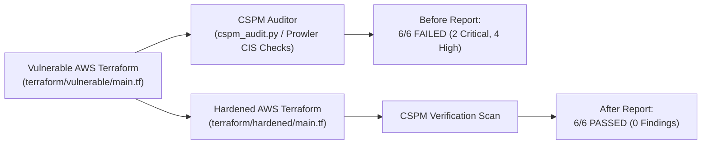
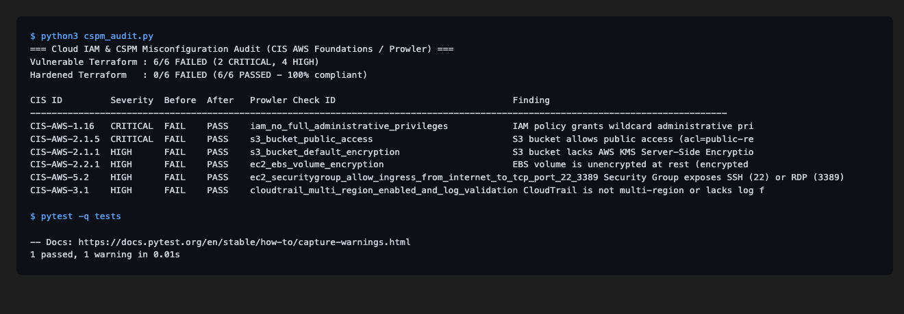

# Cloud IAM & Misconfiguration Audit (AWS CSPM + Terraform Remediation)

**Problem:** Cloud data breaches frequently stem from over-privileged IAM roles (`Action: "*"`), public object storage buckets (`acl = "public-read"`), unencrypted block volumes, internet-exposed management ports (`0.0.0.0/0` on SSH/RDP), and disabled multi-region audit trails.

This project audits an intentionally misconfigured AWS environment against **CIS AWS Foundations Benchmark / Prowler CSPM controls**, documents the blast radius of every finding, and remediates all 6 findings via **Terraform Infrastructure-as-Code (IaC)** to reach 100% compliance.

## Architecture & Remediation Flow



## CSPM Audit Findings & Blast Radius Analysis

| CIS ID | Prowler Check | Severity | Before | After | Blast Radius (If Exploited) | Terraform Remediation |
|---|---|---|---|---|---|---|
| `CIS-AWS-1.16` | `iam_no_full_administrative_privileges` | **CRITICAL** | FAIL | **PASS** | Any compromised service assuming `app-automation-role` gets full AWS account takeover (`Action: "*"`, `Resource: "*"`). | Scoped IAM actions to `s3:GetObject`, `s3:PutObject`, `s3:ListBucket` on `arn:aws:s3:::acme-customer-pii-exports-prod/exports/*` with `aws:SecureTransport = true`. |
| `CIS-AWS-2.1.5` | `s3_bucket_public_access` | **CRITICAL** | FAIL | **PASS** | Unauthenticated internet users can list and download customer PII exports from `acme-customer-pii-exports-prod`. | Set `acl = "private"` and enabled all 4 `aws_s3_bucket_public_access_block` flags. |
| `CIS-AWS-2.1.1` | `s3_bucket_default_encryption` | **HIGH** | FAIL | **PASS** | S3 objects lack customer-managed KMS encryption and key-usage CloudTrail audit events. | Added `aws_s3_bucket_server_side_encryption_configuration` with `sse_algorithm = "aws:kms"` and `bucket_key_enabled = true`. |
| `CIS-AWS-2.2.1` | `ec2_ebs_volume_encryption` | **HIGH** | FAIL | **PASS** | Unencrypted 100 GB database EBS volume exposes plaintext records in snapshots or underlying storage. | Enabled `encrypted = true` with customer-managed `kms_key_id`. |
| `CIS-AWS-5.2` | `ec2_securitygroup_allow_ingress_from_internet_to_tcp_port_22_3389` | **HIGH** | FAIL | **PASS** | Ports 22 (SSH) and 3389 (RDP) open to `0.0.0.0/0` allow internet-wide brute force and exploitation. | Removed port 3389 ingress and restricted port 22 to corporate VPN bastion CIDR `10.24.0.0/24`. |
| `CIS-AWS-3.1` | `cloudtrail_multi_region_enabled_and_log_validation` | **HIGH** | FAIL | **PASS** | Single-region CloudTrail without digest validation allows attackers to operate in unused regions or alter log files undetected. | Enabled `is_multi_region_trail = true`, `enable_log_file_validation = true`, and KMS encryption. |

## Visual Proof

### 1. CSPM Audit Before vs. After


### 2. Least-Privilege IAM & Terraform Remediation Diff


## Artifacts & Deliverables
- Vulnerable Terraform: [terraform/vulnerable/main.tf](terraform/vulnerable/main.tf)
- Hardened Terraform: [terraform/hardened/main.tf](terraform/hardened/main.tf)
- Least-privilege IAM & infrastructure diff: [docs/iam_and_infra.diff](docs/iam_and_infra.diff)
- Structured JSON audit report: [docs/cspm_audit_report.json](docs/cspm_audit_report.json)

## Reproduce Locally
```bash
python3 cspm_audit.py
pytest -q tests
diff -u terraform/vulnerable/main.tf terraform/hardened/main.tf
```

## Resume Bullet
*Conducted an AWS Cloud IAM & CSPM audit mapped to CIS AWS Foundations and Prowler controls; documented blast radius across 6 Critical/High misconfigurations (wildcard IAM policies, public S3 buckets, unencrypted EBS, 0.0.0.0/0 SSH/RDP, single-region CloudTrail) and remediated 100% of findings via hardened Terraform IaC.*
