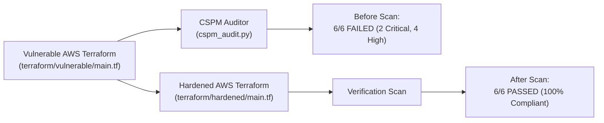
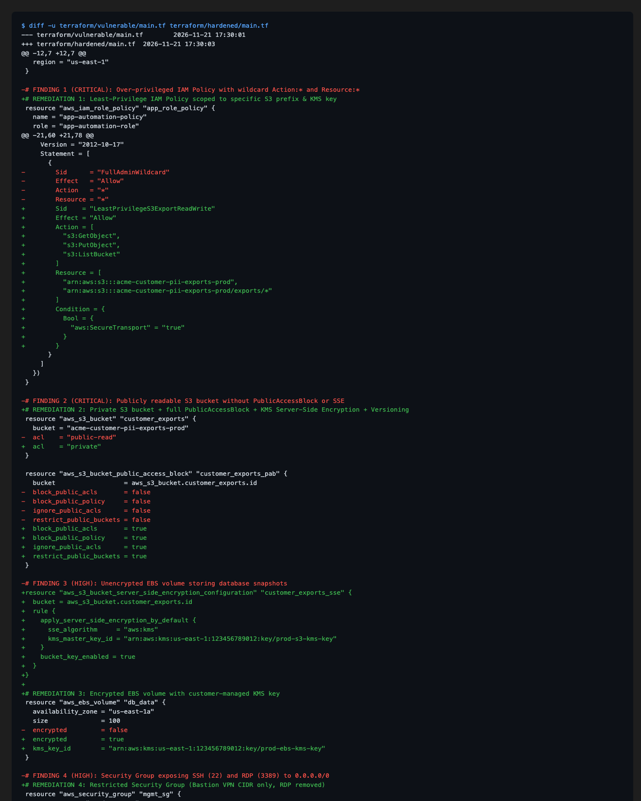

# Cloud IAM & Misconfiguration Audit (AWS CSPM + Terraform Remediation)

## Why I built this
Most cloud breaches do not start with a complex zero-day exploit. They start with an over-privileged IAM role (`Action: "*"`), a storage bucket left public, an unencrypted database volume snapshot, SSH or RDP left open to `0.0.0.0/0`, or CloudTrail logging turned off in secondary regions.

In this project, I built an intentionally misconfigured AWS environment in Terraform ([terraform/vulnerable/main.tf](terraform/vulnerable/main.tf)), wrote a Python CSPM auditor ([cspm_audit.py](cspm_audit.py)) mapped to the **CIS AWS Foundations Benchmark** and **Prowler** check IDs, documented the blast radius of each misconfiguration, and remediated all 6 findings in hardened Terraform Infrastructure-as-Code ([terraform/hardened/main.tf](terraform/hardened/main.tf)).



## Audit findings, blast radius, and how I fixed them
Full line-by-line remediation diff: [docs/iam_and_infra.diff](docs/iam_and_infra.diff).

| CIS Control | Prowler Check ID | Severity | Before | After | Blast Radius (Why it matters) | What I changed in `terraform/hardened/main.tf` |
|---|---|---|---|---|---|---|
| `CIS-AWS-1.16` | `iam_no_full_administrative_privileges` | **CRITICAL** | `FAIL` | **`PASS`** | Any compromised workload assuming `app-automation-role` gets full administrative control (`*:*`) over the entire AWS account. | Scoped `Action` down to `s3:GetObject`, `s3:PutObject`, and `s3:ListBucket` on the single export bucket ARN and `/exports/*` prefix, plus an `aws:SecureTransport = "true"` condition. |
| `CIS-AWS-2.1.5` | `s3_bucket_public_access` | **CRITICAL** | `FAIL` | **`PASS`** | Anyone on the internet can list and download customer PII exports from `acme-customer-pii-exports-prod`. | Changed `acl = "private"` and enabled all four `aws_s3_bucket_public_access_block` flags (`block_public_acls`, `block_public_policy`, `ignore_public_acls`, `restrict_public_buckets`). |
| `CIS-AWS-2.1.1` | `s3_bucket_default_encryption` | **HIGH** | `FAIL` | **`PASS`** | Objects stored in S3 lack customer-managed KMS encryption and key-level CloudTrail audit events. | Added `aws_s3_bucket_server_side_encryption_configuration` enforcing `sse_algorithm = "aws:kms"` with a dedicated KMS key ARN and `bucket_key_enabled = true`. |
| `CIS-AWS-2.2.1` | `ec2_ebs_volume_encryption` | **HIGH** | `FAIL` | **`PASS`** | The 100 GB database EBS volume and its snapshots store customer records in cleartext at rest. | Set `encrypted = true` on `aws_ebs_volume.db_data` and attached a customer-managed KMS key (`prod-ebs-kms-key`). |
| `CIS-AWS-5.2` | `ec2_securitygroup_allow_ingress_from_internet_to_tcp_port_22_3389` | **HIGH** | `FAIL` | **`PASS`** | Exposing SSH (`22`) and RDP (`3389`) to `0.0.0.0/0` invites continuous automated credential stuffing and brute-force attacks. | Removed port `3389` ingress completely and restricted TCP port `22` to the internal corporate VPN bastion subnet (`10.24.0.0/24`). |
| `CIS-AWS-3.1` | `cloudtrail_multi_region_enabled_and_log_validation` | **HIGH** | `FAIL` | **`PASS`** | An attacker can spin up resources in an unmonitored AWS region or tamper with delivered log files in S3 without detection. | Set `is_multi_region_trail = true`, enabled SHA-256 digest verification (`enable_log_file_validation = true`), and encrypted logs with KMS. |

## Visual proof

### 1. CSPM audit output (before vs. after)


### 2. Terraform IAM and infrastructure remediation diff


Structured JSON audit output: [docs/cspm_audit_report.json](docs/cspm_audit_report.json).

## How to run it
```bash
python3 cspm_audit.py
pytest -q tests
diff -u terraform/vulnerable/main.tf terraform/hardened/main.tf
```
